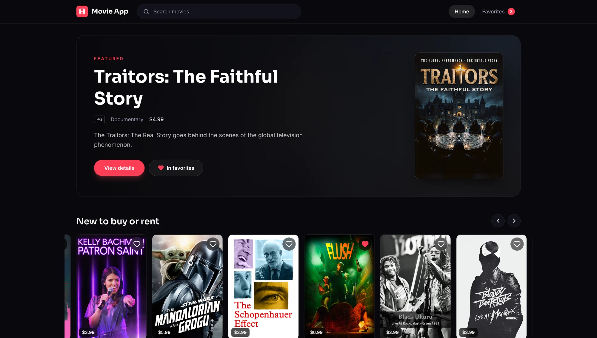
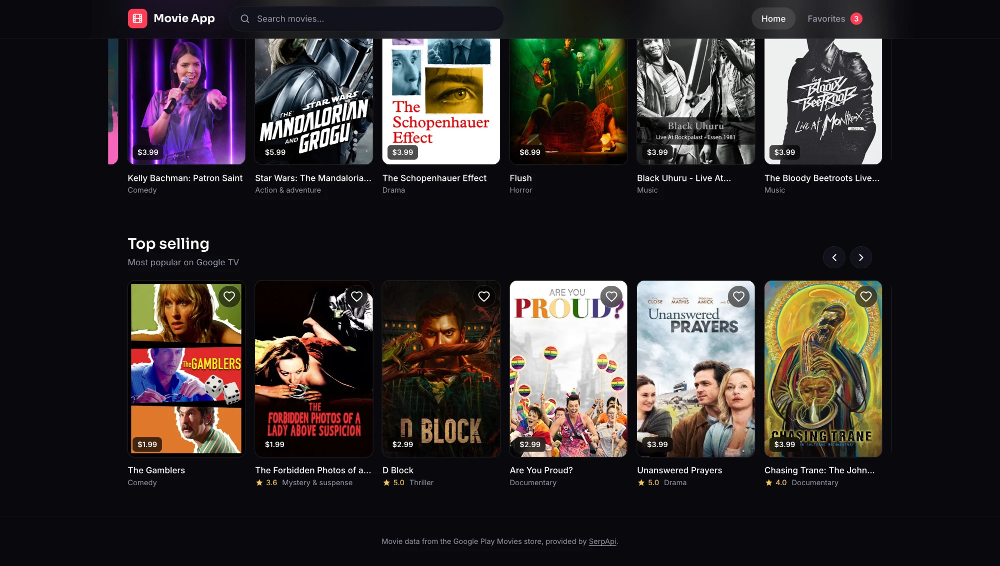
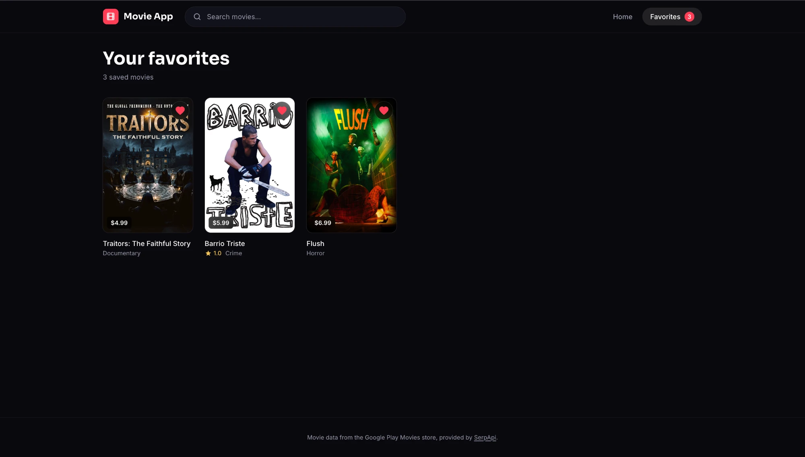

# Movie App

Browse, search and save movies from the Google Play Movies store.
Built with React 19, Vite, Tailwind CSS 4 and React Router. Movie data comes
from [SerpApi's Google Play Movies API](https://serpapi.com/google-play-movies).

## Screenshots

**Home** with the featured movie and store rows



**Browse** rows scroll horizontally, like the Play Store



**Favorites** are saved in the browser



**Mobile**


## Setup

```bash
npm install
cp .env.example .env     # then put your key in .env
npm run dev
```

Get an API key at <https://serpapi.com/manage-api-key>.

```
# .env
SERPAPI_KEY=your_key_here
```

> **Never prefix the key with `VITE_`.** Only `VITE_*` variables are bundled
> into the browser code, and a SerpApi key is private. `.env` is git-ignored.

Restart the dev server after changing `.env`.

## How the API key stays private

The browser only ever calls `/api/movies`. The Vite dev / preview server
([vite.config.js](vite.config.js)) forwards that to
`https://serpapi.com/search.json`, adds `engine` and `api_key`, and only passes
through a whitelist of query parameters.

That proxy exists in `npm run dev` and `npm run preview` only. A static
deployment of `dist/` has no `/api/movies`, so before deploying you need a
small server-side function that does the same thing (Vercel, Netlify or
Cloudflare functions all work) and holds `SERPAPI_KEY` as a secret.

## Things to know

- **Quota.** Every search costs one SerpApi search. Responses are cached for an
  hour in `sessionStorage` (the same window SerpApi caches for), and search runs
  on submit rather than on every keystroke.
- **Movies only.** Search results also contain TV shows and episodes; they are
  filtered out.
- **Detail pages** use data from movies already loaded in the session, so a
  `/movie/:id` link opened cold in a new tab shows "Movie not found".
- **Favorites** are stored in `localStorage` under `favorites.v2`. The old TMDB
  version used `favorites`, which is deleted on first load.

## iCloud note (macOS)

This project lives in a folder that macOS syncs to iCloud (`~/Desktop`). iCloud
can evict files to the cloud, which makes `node_modules` unreadable and hangs
Vite, ESLint and builds (reads fail with `ECANCELED`). To avoid that,
`node_modules` is a symlink to `node_modules.nosync`, a name iCloud never
syncs. If you reinstall and npm replaces the symlink with a real folder, run:

```bash
mv node_modules node_modules.nosync && ln -s node_modules.nosync node_modules
```

Moving the project outside `~/Desktop` / `~/Documents` avoids the problem too.

## Scripts

| Command           | What it does                    |
| ----------------- | ------------------------------- |
| `npm run dev`     | Dev server with the API proxy   |
| `npm run build`   | Production build into `dist/`   |
| `npm run preview` | Serve the build (with the proxy)|
| `npm run lint`    | ESLint                          |
